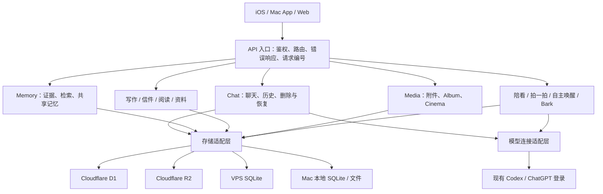

# Vesper 后端架构与维护入口

更新：2026-10-14。本文对应本次后端整理的代码；数据沿用现有存储。

## 现在的分层

功能模块负责自己的业务规则。API 入口负责身份检查、参数转交与响应；模型适配层负责连接、RPC 与进程生命周期。资料 HTTP API 和模型工具共用 `DocumentRepository`，附件上传与工具发文件共用 `MediaRepository`。

现有功能仍在原有 Worker、VPS 服务和 Mac 后端中运行。模块之间通过明确的入口协作。

## 每类数据的主存储

| 数据 | VPS 模式的主存储 | Mac 模式的主存储 |
| --- | --- | --- |
| 聊天记录、删除标记、通知回执、陪看与拍一拍任务 | VPS `~/.vesper/chat-history.sqlite3` | `~/Library/Application Support/VesperBackend/backend.sqlite3` |
| 联系人资料、日记、提醒、阅读与其他应用文档 | Cloudflare D1 `vesper-db` | Mac `backend.sqlite3` 的文档记录 |
| 共享记忆 | Cloudflare D1 `memory-db` | Mac 本地记忆及明确标注来源的手动导入副本 |
| 记忆证据、检索/交付记录、Desire 状态 | 对应 D1 功能表 | Mac 已支持的本地功能表 |
| 聊天附件、Album 图片 | Cloudflare R2 `vesper-media`；元数据在 D1 / 聊天档案中 | Mac `media/`；元数据在本地 SQLite |
| 自主唤醒调度、计划、工作流回执 | VPS `~/.vesper/wake.sqlite3` | 使用 Mac 后端实际支持的能力 |
| Cinema B 站播放文件 | VPS 临时 `watch-cache/`；退出释放，过期自动清理 | 本地播放器访问用户选择的文件 |
| 模型原始过程记录 | 对应 Codex profile 的 `sessions/` | Mac 后端独立 `codex/sessions/` |

手机保存近期消息、草稿、资料快照和待同步队列。它们按后端与账号隔离。确认写入和删除的依据来自对应后端；失败时保留本地内容。模型原始记录与可展示聊天档案各有用途；已删除内容受到现有删除标记约束。

## 代码入口

### Cloudflare / Web 仓库

- `lib/backend/http.ts`：配对鉴权、方法限制、每请求身份上下文、CORS/缓存策略、统一错误和安全日志。
- `lib/backend/documents.ts`：应用文档读写；并发更新通过条件写入重读重试，修改函数只处理数据。
- `lib/backend/media.ts`：R2 附件字节和 HTTP 元数据。
- `lib/backend/services.ts`：绑定真实存储的组装入口。
- `app/api/state`、`photos`、`media`、`jottings`、`bookmarks`、`letters`、`memory/messages`：使用共享入口的 HTTP 适配器。
- `lib/codex-tools.ts`：工具分发与业务协调，复用文档存储；现有 Memory、Desire、信件、阅读等专门模块继续负责各自业务。
- `lib/db.ts`：D1 schema 初始化；初始化失败后，下次请求允许重新尝试。

### VPS

- `vps/codex_history_server.py`：应用组装、HTTP 鉴权、请求体解析、统一响应与日志、后台服务启动。
- `vps/vesper_backend/router.py`：领域路由注册表；普通路由在鉴权后执行，既有媒体能力链接单独验证。
- `vps/vesper_backend/*_routes.py`：history、media、tools、notifications、companion、automation 的路由适配器。
- `vps/vesper_backend/adapters.py`：HTTP 输入与领域结果的转换。
- `vps/vesper_backend/chat.py`：`ChatService` 聊天业务；不接触 HTTP socket、鉴权或响应头。
- `vps/vesper_backend/contracts.py`：聊天记录结构、附件/攒消息验证、序列化规则。
- `vps/vesper_backend/storage.py`：SQLite 连接与兼容迁移；一次成功初始化后，常规请求复用已完成的 schema 状态。
- `vps/vesper_backend/codex_provider.py`：共享 stdio 模型连接。陪看、拍一拍直接使用；自主唤醒保留兼容入口。
- `vesper_screen_companion.py`、`vesper_companion_poke.py`、`vesper_bark.py`、`vesper_watch.py` 与 `vesper_wake_*`：各自的任务、权限、采样、通知、计划和生命周期规则。

### 原生仓库的 Mac 后端

- `mac-backend/server.mjs`：组装、模型 WebSocket、只读观察者与进程生命周期。
- `mac-backend/http-api.mjs`：HTTP 业务入口。
- `mac-backend/http-helpers.mjs`：鉴权比较、请求体、响应与通用验证。
- `mac-backend/codex-process.mjs`：本地模型进程适配器，使用 Mac 的独立 profile。
- `mac-backend/storage.mjs`：本地 SQLite、删除标记、历史与原子导入。
- `mac-backend/media.mjs`：本地附件与文件工具。
- `mac-backend/install.py`：安装上述模块到现有 LaunchAgent runtime。

## 本次修正的保存行为

1. VPS JSON 成功响应等数据库事务提交完成后发送；提交失败返回未确认，而不会先返回成功。
2. 日记、提醒与纪念日的模型写入复用条件更新，重读时保留用户或另一端刚写入的内容。
3. D1 初始化失败可以恢复，避免一个临时错误让后续请求一直失败。
4. 请求日志记录服务、方法、状态、耗时、请求编号；不记录凭证、请求正文、画面、模型输入或 URL 查询参数。
5. 模型连接共用传输适配层；业务模块分别保留工具权限和回复规则。未确认的模型调用沿用原有核对/回执机制。

跨 Cloudflare 与 VPS 的操作仍通过既有回执、稳定 ID、待同步队列与重试机制协作。数据库事务的原子性限于对应数据库；跨服务操作需要确认每一步结果。

## 后续加功能的规则

- 明确数据所属后端、账号与会话，以及主存储；调用已有 repository / 业务模块。
- HTTP 路由只转交业务调用；业务模块输出领域结果，模型连接细节交给 provider。
- 重试读与数据条件更新；涉及模型生成或外部副作用时使用稳定 ID 和现有回执确认，避免重做已完成的动作。
- 业务模块分别维护对应的契约检查。入口/存储变化需运行涉及的历史、权限、删除、并发与任务回归。
- 云端从检查通过并合入 `main` 的版本部署到既有 Worker；VPS 更新先核对当前代码与活跃任务，保留兼容的线上修复和已有数据；Mac 后端在没有进行中模型任务时更新 runtime。
